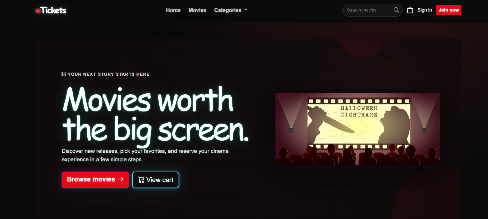
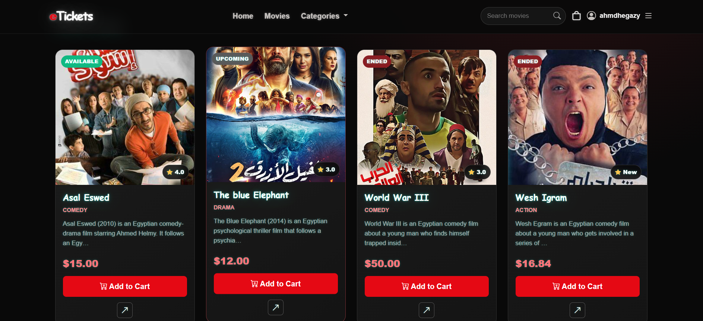
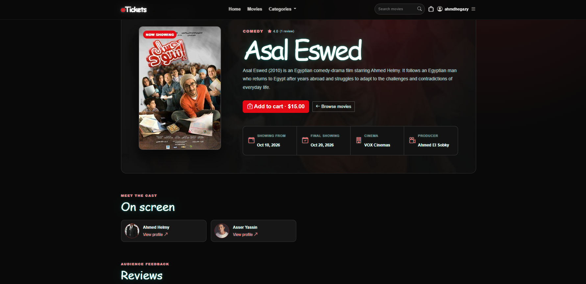
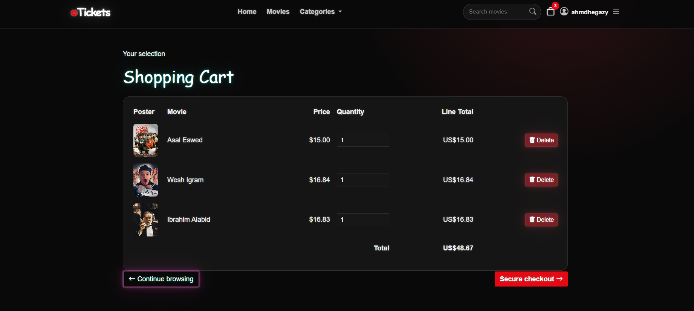
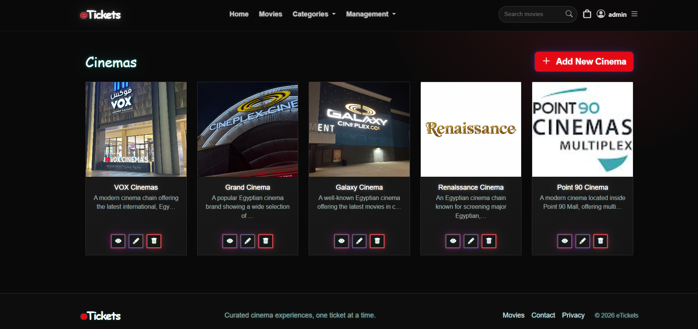
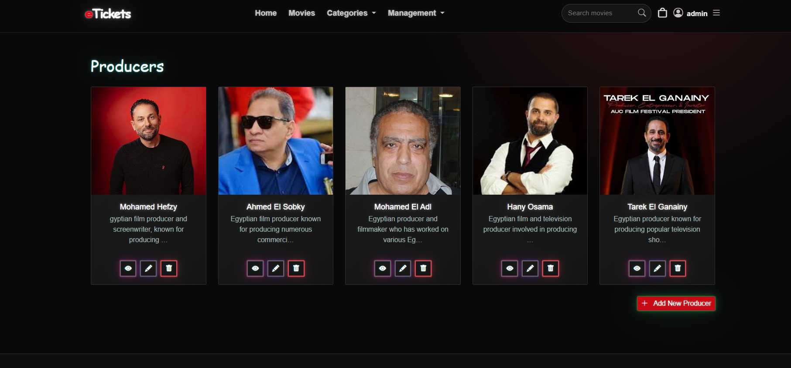

# 🎬 eTickets

> A cinema ticketing web application built with ASP.NET Core MVC, Entity Framework Core, and SQL Server.
> Supports movie discovery, shopping cart management, PayPal checkout, customer reviews, and role-based administration.

[](https://dotnet.microsoft.com)
[](https://dotnet.microsoft.com/apps/aspnet)
[](https://www.microsoft.com/en-us/sql-server)
[](https://developer.paypal.com/)

---

## Table of Contents

* [Tech Stack](#tech-stack)
* [Features](#features)
* [Screenshots](#screenshots)
* [Architecture](#architecture)
* [Getting Started](#getting-started)

  * [Prerequisites](#prerequisites)
  * [Clone the Repository](#1-clone-the-repository)
  * [Configure the Database](#2-configure-the-database)
  * [Apply Migrations](#3-apply-database-migrations)
  * [Configure Administrator Account](#4-configure-administrator-account)
  * [Configure PayPal](#5-configure-paypal)
  * [Run the Application](#6-run-the-application)
* [Roles & Permissions](#roles--permissions)
* [Project Structure](#project-structure)
* [Author](#author)

---

## Tech Stack

| Layer               | Technology                         |
| ------------------- | ---------------------------------- |
| Framework           | ASP.NET Core 10 MVC                |
| Language            | C#                                 |
| ORM                 | Entity Framework Core 8            |
| Database            | Microsoft SQL Server               |
| Authentication      | ASP.NET Core Identity              |
| Authorization       | Role-based authorization           |
| Mapping             | AutoMapper                         |
| Payments            | PayPal REST API                    |
| Frontend            | Razor Views, HTML, CSS, JavaScript |
| UI Framework        | Bootstrap 5                        |
| Icons               | Bootstrap Icons                    |
| Database Management | EF Core Code-First Migrations      |
| Configuration       | .NET User Secrets                  |

---

## Features

* **User Authentication** - registration, login, and profile management using ASP.NET Core Identity
* **Movie Catalog** - browse movies, filter by category, and search by name
* **Movie Details** - view cast, producer, cinema, price, showing dates, and customer reviews
* **Actors & Producers** - dedicated listing and details pages
* **Cinema Management** - browse cinemas and view their details
* **Shopping Cart** - session-based cart with quantity updates and item removal
* **PayPal Checkout** - payment processing using PayPal's order creation and capture flow
* **Order Management** - customer order history, order details, and administrator order management
* **Movie Reviews** - submit 1–5 star ratings with optional comments
* **Review Moderation** - customers can delete their own reviews; administrators can delete any review
* **Admin Management** - create, edit, and delete movies, actors, producers, and cinemas
* **Role-Based Access** - separate permissions for guests, customers, and administrators
* **Security** - account lockout, password requirements, secure authentication cookies, and antiforgery protection
* **Custom Error Pages** - dedicated 404 and general error pages
* **Contact Page** - a page for users to contact the application team

---

## Screenshots

### Movie Browsing

| Home Page | Movies Page |
|:---:|:---:|
|  |  |

| Movie Details | Shopping Cart |
|:---:|:---:|
|  |  |

### Admin Management

| Cinemas Management | Producers Management |
|:---:|:---:|
|  |  |

---

## Architecture

The solution follows a three-layer architecture to separate presentation, business logic, and data access.

```text
┌─────────────────────────────────┐
│            eTickets             │
│        Presentation Layer       │
│                                 │
│   Controllers, Views, Services  │
└────────────────┬────────────────┘
                 │
                 ▼
┌─────────────────────────────────┐
│        eTickets.Business        │
│          Business Layer         │
│                                 │
│      Interfaces & Services      │
└────────────────┬────────────────┘
                 │
                 ▼
┌─────────────────────────────────┐
│          eTickets.Data          │
│           Data Layer            │
│                                 │
│ Models, Repositories, DbContext │
│ Configurations & Migrations     │
└────────────────┬────────────────┘
                 │
                 ▼
┌─────────────────────────────────┐
│           SQL Server            │
└─────────────────────────────────┘
```

---

## Getting Started

### Prerequisites

* [.NET 10 SDK](https://dotnet.microsoft.com/download/dotnet/10.0)
* SQL Server, SQL Server Express, or LocalDB
* [Git](https://git-scm.com/)
* Entity Framework Core CLI

Install the EF Core CLI if it is not already installed:

```bash
dotnet tool install --global dotnet-ef
```

### 1. Clone the Repository

```bash
git clone https://github.com/Ahm3dHegazy/eTickets.git
cd eTickets
```

### 2. Configure the Database

The default connection string in `eTickets/appsettings.json` uses a local SQL Server instance with Windows authentication:

```text
Server=.;Database=eTickets;Integrated Security=True;TrustServerCertificate=True;
```

If your SQL Server instance uses a different configuration, set your connection string using .NET User Secrets:

```bash
dotnet user-secrets set "ConnectionStrings:DefaultConnection" "<your-connection-string>" --project eTickets
```

Replace `<your-connection-string>` with your actual SQL Server connection string.

### 3. Apply Database Migrations

Run the following command from the solution root:

```bash
dotnet ef database update --project eTickets.Data --startup-project eTickets
```

This creates or updates the database using the existing Entity Framework Core migrations.

On the first application run, the application seeds sample cinemas, producers, actors, and movies if no cinemas exist. It also creates the `Administrator` and `Customer` roles.

### 4. Configure Administrator Account

The application creates an administrator account at startup only when both settings are configured.

Set the administrator email:

```bash
dotnet user-secrets set "SeedAdmin:Email" "admin@example.com" --project eTickets
```

Set the administrator password:

```bash
dotnet user-secrets set "SeedAdmin:Password" "YourStrongPassword1" --project eTickets
```

The password must meet the application's password requirements:

* At least 8 characters
* At least one digit
* At least one uppercase letter
* At least one lowercase letter

**Important:** Never commit real credentials or passwords to source control.

### 5. Configure PayPal

PayPal sandbox credentials are required to test the checkout process.

**1.** Create a sandbox application in the [PayPal Developer Dashboard](https://developer.paypal.com/).

**2.** Configure your Client ID:

```bash
dotnet user-secrets set "PayPal:ClientId" "<sandbox-client-id>" --project eTickets
```

**3.** Configure your Client Secret:

```bash
dotnet user-secrets set "PayPal:ClientSecret" "<sandbox-client-secret>" --project eTickets
```

### PayPal Settings

| Setting               | Default        | Description                      |
| --------------------- | -------------- | -------------------------------- |
| `PayPal:UseSandbox`   | `true`         | Enables PayPal sandbox mode      |
| `PayPal:Currency`     | `USD`          | Currency used for orders         |
| `PayPal:ClientId`     | Not configured | PayPal application Client ID     |
| `PayPal:ClientSecret` | Not configured | PayPal application Client Secret |

The application uses PayPal's order creation and capture flow.

Other features can be explored without configuring PayPal, but checkout requires valid credentials.

### 6. Run the Application

Run the application using the HTTPS launch profile:

```bash
dotnet run --project eTickets --launch-profile https
```

Open the application in your browser:

* **HTTPS:** `https://localhost:7001`
* **HTTP:** `http://localhost:5080`

These URLs assume the corresponding ports are configured in `launchSettings.json`.

Use HTTPS when testing authentication because authentication cookies are configured as secure-only.

---

## Roles & Permissions

| Feature                                       | Guest | Customer | Administrator |
| --------------------------------------------- | :---: | :------: | :-----------: |
| Browse and search movies                      |   ✅   |     ✅    |       ✅       |
| Browse actors, producers, and cinemas         |   ✅   |     ✅    |       ✅       |
| Use shopping cart                             |   ✅   |     ✅    |       ✅       |
| Checkout with PayPal                          |   ❌   |     ✅    |       ✅       |
| View personal order history                   |   ❌   |     ✅    |       ✅       |
| Submit movie reviews                          |   ❌   |     ✅    |       ✅       |
| Delete own reviews                            |   ❌   |     ✅    |       ✅       |
| Manage movies, actors, producers, and cinemas |   ❌   |     ❌    |       ✅       |
| View all customer orders                      |   ❌   |     ❌    |       ✅       |
| Delete orders                                 |   ❌   |     ❌    |       ✅       |
| Delete any review                             |   ❌   |     ❌    |       ✅       |

---

## Project Structure

```text
eTickets/
│
├── eTickets/                       # ASP.NET Core MVC application
│   ├── Controllers/                # MVC request handlers
│   ├── Views/                      # Razor views
│   ├── ViewModels/                 # View and request models
│   ├── Services/                   # PayPal integration
│   ├── Configuration/              # PayPal options
│   ├── Mapping/                    # AutoMapper profiles
│   ├── wwwroot/                    # CSS, JavaScript, images, libraries
│   ├── appsettings.json            # Application configuration
│   └── Program.cs                  # Application entry point
│
├── eTickets.Business/              # Business logic layer
│   ├── Interfaces/                 # Service contracts
│   └── Services/                   # Service implementations
│
├── eTickets.Data/                  # Data access layer
│   ├── Models/                     # Entity models
│   ├── Configurations/             # EF Core entity configurations
│   ├── Repository/                 # Repository implementations
│   ├── Migrations/                 # Database migrations
│   └── Data/                       # DbContext and seeders
│
└── eTickets.slnx                   # Solution file
```

---

## Security Notes

* Keep PayPal credentials and administrator passwords out of source control.
* Use .NET User Secrets for local development.
* Use HTTPS when testing authentication.
* Use sandbox credentials for PayPal testing.
* Configure production credentials through your deployment environment rather than committing secrets to `appsettings.json`.

---

## Author

**Ahmed Abdel Samea Hegazy**

* GitHub: [@Ahm3dHegazy](https://github.com/Ahm3dHegazy)

---

<p align="center">
  Built with ❤️ using ASP.NET Core MVC
</p>
